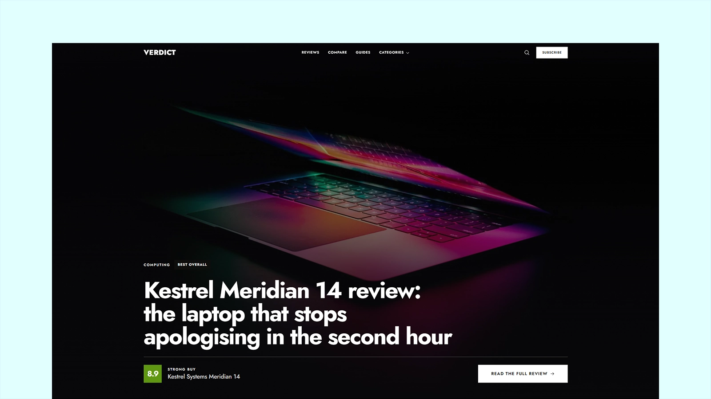

# Verdict - Astro Review & Affiliate Theme

[](https://verdict.xocoweb.workers.dev/)

[](https://astro.build/)
[](https://tailwindcss.com/)
[](https://mdxjs.com/)
[](https://www.typescriptlang.org/)
[](./LICENSE)

**Live preview:** https://verdict.xocoweb.workers.dev/

Verdict is a premium Astro theme for review publications and affiliate sites. It publishes three things — scored reviews, product comparisons, and regular posts — and gives all three the same commercial building blocks: score badges computed from a published breakdown, pros and cons, specification tables, and retailer buy boxes that carry your affiliate `rel` and disclosure automatically. A product's retailers and specifications live in the frontmatter of the review that covers it, so publishing a review means editing one file, and the same blocks drop into a plain post through a small set of MDX components. The output is static, with no framework islands to hydrate.

## Features

- Reviews, comparisons, and posts as Astro content collections, with frontmatter validated for products, retailers, specifications, weighted scores, pros and cons, awards, and revision dates
- A review publishes a weighted breakdown and the headline number is its weighted average, computed at build time, so the badge can never disagree with the table under it
- Five score bands with their own colours, labels, and meanings, all defined in one config file — move to a 5-point scale by editing `src/config/scoring.ts`
- Seven award keys usable in review frontmatter and on a roundup pick, editable in the same file
- Comparison tables where products are columns and criteria are rows, the winning cell marked in each row, and the criterion column pinned while the product columns scroll horizontally on a phone
- A buy box listing every retailer, an inline `<BuyButton>`, and a `<Pick>` block for roundups; the configured `rel` goes on every outbound retailer link, and the disclosure prints under the retailer table and beside the button
- `affiliate.enabled: false` keeps the retailer lists and drops the disclosure, for a publication that links out without earning a commission
- MDX components for post bodies — `<Pick>`, `<BuyButton>`, `<Callout>`, `<KeyNumbers>`, and `<TestBench>`, plus `<SpecTable>` and `<ProsCons>` from the review page — enough to build a roundup, a buying guide, or a measurement-heavy explainer without touching the schema
- Paginated review, comparison, blog, and category archives through one shared layout, plus tag and reviewer pages, all built on a single `ArticleCard`
- A full-width category menu in the header, one tile per desk carrying the cover of its most recent article, opening and closing on explicit state rather than on a chain of CSS hovers
- Built-in client-side search with a keyboard command palette (`/` or `⌘K`) and a dedicated results page, both reading one build-time index that covers product names and brands, not only headlines
- A share sheet with eleven targets — Facebook, X, LinkedIn, email, WhatsApp, Telegram, and Threads, with Bluesky, Mastodon, Reddit, and Pinterest folded behind _More_ — plus the page link and a copy button, built as a native `<dialog>` so the focus trap, the Escape key, and the backdrop are the browser's
- Revision dates treated as first-class: with `updatedDate` set, cards and article headers print it instead of the publication date, the RSS feed re-sorts on it, and the article footer prints a dated revision note
- A colour per category, defined as three gradient stops in `src/config/categories.ts` and carried to the band behind an article headline and the face of its category card
- No featured-image requirement — article pages open on the category gradient band rather than a hero photo, so a post only needs a cover for its card
- One radius scale, set to `0` for a square interface, so rounding the whole theme is a two-line change
- Pure-CSS motion — load entrances, scroll-driven reveals, and hover polish that ship no JavaScript at all, flattened under `prefers-reduced-motion`
- Two self-hosted variable fonts (Jost, Inter), subset to latin and latin-ext, with no monospaced webfont shipped at all
- Static output with no framework islands; client JavaScript is limited to four progressive-enhancement scripts — the header's search palette and menus, the share sheet, the search results page, and the reading-progress bar
- Structured data that matches the page — `Review` with the same rating and scale that is printed, `Article` for everything else
- Canonical URLs, sitemap generation, RSS, Open Graph, Twitter/X cards, and JSON-LD
- Accessible skip link, landmarks, one `h1` per page, visible focus styles, keyboard-operable menus and dialogs with focus trapping, and alt text on every meaningful image

## Tech Stack

- Astro 7 with MDX
- Tailwind CSS 4 via the Vite plugin
- Vite 8, TypeScript, Astro content collections
- `@astrojs/sitemap`, `@astrojs/markdown-remark` with `rehype-slug` for heading anchors, Sharp
- Self-hosted Jost and Inter variable fonts, and a local Phosphor icon set with its license notice

## Requirements

- Node.js `22.12.0` or newer
- npm

## Getting Started

```bash
npm install
npm run dev
```

Build for production:

```bash
npm run build
```

Preview the production build locally:

```bash
npm run preview
```

Before shipping a change, run type checking, the production build, and the formatter check together:

```bash
npm run release:check
```

## Customization

See [CUSTOMIZATION.md](./CUSTOMIZATION.md) for site settings, affiliate behaviour, categories and scoring, the frontmatter of all three content types, every MDX component's props, the routes, images, search, forms, motion, and the theme's design tokens.

Set `siteConfig.siteUrl` before building — canonical URLs, Open Graph images, the sitemap, and the RSS feed are all derived from it. The build is static, so any host that serves a directory works: `wrangler.jsonc` is included for Cloudflare Workers, and Netlify, Vercel, GitHub Pages, and object storage behind a CDN need no configuration beyond `npm run build`.

## Content

Reviews live in [src/content/reviews](./src/content/reviews) — each is a folder with an `index.mdx`, a cover, and a product shot. Comparisons are in [src/content/comparisons](./src/content/comparisons) and posts in [src/content/posts](./src/content/posts), both keeping their images beside the entry that uses them. All three are validated by the schemas in [src/content.config.ts](./src/content.config.ts).

The bundled demo content is fictional. The brands, products, measurements, and reviewer bylines are invented so the theme can demonstrate scored reviews without publishing fake claims about real products — **replace all of it before launch.** Demo photography comes from [Unsplash](https://unsplash.com/) under the [Unsplash License](https://unsplash.com/license), and every image carries its photographer and source URL in the frontmatter that renders it. Product photos inevitably show real brands; they are placeholders for the fictional products. Reviewer portraits are Unsplash placeholders of models with no connection to the fictional bylines, recorded in `src/config/authors.ts`.

## Support

See [SUPPORT.md](./SUPPORT.md) for what a license includes, and [CHANGELOG.md](./CHANGELOG.md) for release history.

## License

Commercial license. See [LICENSE](./LICENSE) for complete terms.
